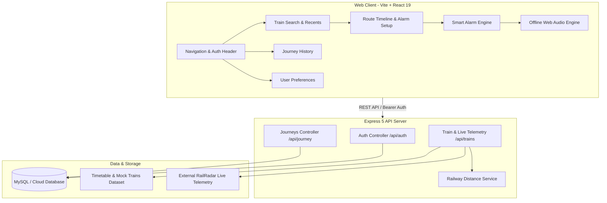

# RailSafe Alert – Smart Destination Alarm System for Railway Passengers

Many passengers travel overnight and sleep during railway journeys. Due to train delays and unexpected route changes, passengers cannot rely on static timetables and frequently miss their destination station. Existing train-tracking apps display live train locations but do not automatically wake passengers up when their specific station is approaching.

**RailSafe Alert** continuously tracks the train's live location and railway kilometrage, calculates dynamic ETA and real remaining track distance, and triggers a multi-sensory smart alarm (offline Web Audio synthesized tones, device vibration, voice text-to-speech announcement, and push notifications) before arrival.

---

## Group Members & Roles

| S.No. | Name | Roll Number | Role |
| :---: | :--- | :--- | :--- |
| 1 | **Chodipalli Yashwanth** | 2024BCS0274 | **Team Leader & Backend Developer**: Lead the project, design/develop backend services, implement business logic for alerts, manage auth/APIs, and integrate backend with DB/frontend. |
| 2 | **Akash Yadav** | 2024BCS0250 | **Frontend Developer**: Design UI/UX, develop login/search/destination screens, display live location/ETA, implement alarm settings, and connect frontend with APIs. |
| 3 | **Ankit Kumar** | 2024BCS0262 | **Database & API Integration**: Design/manage DB, integrate live train APIs, store user profiles/journey details, optimize performance, and ensure secure communication. |
| 4 | **Guguloth Sriram Prabhas** | 2024BCS0234 | **Testing, Documentation & UML Designer**: Perform functional/system testing, resolve bugs, prepare documentation, design UML diagrams, and assist in presentation/report preparation. |

---

## Key Features

- **User Authentication & Cloud Sync**: Registration, login, profile management, and persistent journey synchronization across devices.
- **Smart Train Search**: Search by 5-digit train number, train name, or route (e.g., `12951`, `Vande Bharat`, `New Delhi to Mumbai`).
- **Destination & Station Selection**: Interactive station picker along the complete route timeline.
- **Official Railway Track Kilometrage**: Uses official Indian Railways track distances (`railwayDistanceService`), cumulative kilometrage, and tortuosity validation rather than straight-line GPS.
- **Dynamic Live Telemetry & ETA**: Real-time tracking via RailRadar API proxy with automated fallback to verified timetable dataset and demo train profiles.
- **Resilient Offline Smart Alarm**:
  - Configurable alert distance threshold (2 km, 5 km, 10 km, 15 km) or time-based wake-up.
  - Zero-latency synthesized alarm tones (Digital Watch, Warning Siren, Gentle Chime) via HTML5 Web Audio API that work 100% offline.
  - Device vibration alert patterns.
  - Voice Text-To-Speech (TTS) spoken announcements.
  - Browser/Desktop Push Notifications.
- **Trip History & Journeys Management**: View active and completed journeys, with one-click re-tracking and cancellation.
- **Theme & Sound Preferences**: Dark Glassmorphic (default), Midnight Deep Blue, and Light mode with preview sound and vibration tests.
- **Railway Emergency Helpline (139)**: One-tap direct call for medical, security, and passenger assistance.

---

## Competitor Analysis

| Features | Where is My Train | NTES | RailYatri | ConfirmTkt | ixigo Trains | RailSafe Alert |
| :--- | :---: | :---: | :---: | :---: | :---: | :---: |
| Live Train Tracking | ✅ | ✅ | ✅ | ✅ | ✅ | ✅ |
| ETA Calculation | ✅ | ✅ | ✅ | ✅ | ✅ | ✅ |
| Delay Information | ✅ | ✅ | ✅ | ✅ | ✅ | ✅ |
| Smart Destination Alarm | ❌ | ❌ | ❌ | ❌ | ❌ | ✅ |
| Loud Alarm (Locked Phone) | ❌ | ❌ | ❌ | ❌ | ❌ | ✅ |
| Voice Announcement Alert | ❌ | ❌ | ❌ | ❌ | ❌ | ✅ |
| Dynamic Alarm on Delays | ❌ | ❌ | ❌ | ❌ | ❌ | ✅ |
| Track Kilometrage Validation | ❌ | ❌ | ❌ | ❌ | ❌ | ✅ |
| Offline Synthesizer Alarm | ❌ | ❌ | ❌ | ❌ | ❌ | ✅ |

---

## System Architecture



---

## Project Structure

```
rail_safe_alert/
├── backend/
│   ├── config/
│   │   ├── database.js          # Sequelize connection configuration
│   │   └── env.js               # Centralized environment variable management
│   ├── data/
│   │   ├── allTrains.json       # 1,160+ bundled trains timetable
│   │   ├── demoTrains.js        # High-fidelity verified route profiles
│   │   ├── mockTrains.json      # Structured mock trains dataset
│   │   └── stations.json        # GeoJSON station coordinates
│   ├── middleware/
│   │   └── auth.js              # Bearer & x-auth-token JWT middleware
│   ├── models/
│   │   ├── Journey.js           # Journey Sequelize model
│   │   ├── Train.js             # Train Sequelize model
│   │   └── User.js              # User Sequelize model
│   ├── routes/
│   │   ├── auth.js              # Register, login, profile routes with validation
│   │   ├── journey.js           # Journey creation, list, status, deletion
│   │   └── trains.js            # Search, live telemetry proxy, route details
│   ├── services/
│   │   └── railwayDistanceService.js  # Track kilometrage & tortuosity service
│   ├── tests/
│   │   ├── api.test.js          # API integration tests
│   │   └── railwayDistance.test.js # Distance calculation tests
│   ├── server.js                # Express app entry point & middleware
│   └── package.json
│
├── web-frontend/
│   ├── public/                  # Static assets & icons
│   ├── src/
│   │   ├── components/
│   │   │   ├── AuthModal.jsx    # Sign in, registration & account modal
│   │   │   ├── Navbar.jsx       # Responsive navigation bar
│   │   │   └── StationTimelineNode.jsx # Route station node component
│   │   ├── config/
│   │   │   └── api.js           # Centralized API base URL config
│   │   ├── data/
│   │   │   ├── allTrains.json   # Frontend train timetable
│   │   │   └── trainsData.js    # Verified demo map & search index
│   │   ├── pages/
│   │   │   ├── ActiveAlarm.jsx  # Active monitoring & destination alarm
│   │   │   ├── Home.jsx         # Search and quick demo train launcher
│   │   │   ├── Journeys.jsx     # Saved journey history
│   │   │   ├── Settings.jsx     # Themes, alarm sound & vibration test
│   │   │   └── TrainDetails.jsx # Route details & alert threshold configuration
│   │   ├── services/
│   │   │   └── liveTrackingService.js # Telemetry normalizer & backend proxy
│   │   ├── utils/
│   │   │   ├── alarmAudioService.js  # Web Audio synthesizer, TTS & vibration
│   │   │   ├── authService.js   # JWT session & profile client
│   │   │   ├── journeyService.js# Trip history persistence
│   │   │   ├── railwayDistance.js # Client-side route kilometrage math
│   │   │   ├── settingsService.js# User preferences persistence
│   │   │   └── timeUtils.js     # IST timezone, delay & live ETA helpers
│   │   ├── App.jsx              # Main router & layout container
│   │   ├── index.css            # Design system, themes & glassmorphism
│   │   └── main.jsx
│   ├── tests/
│   │   └── timeUtils.test.js    # Frontend unit test suite
│   ├── vite.config.js
│   └── package.json
│
├── api/                         # Vercel Serverless entrypoints
├── package.json                 # Monorepo root scripts
├── vercel.json                  # Production deployment configuration
└── README.md
```

---

## Getting Started

### Prerequisites

- **Node.js**: v18.0.0 or higher (v20+ or v22+ recommended)
- **npm**: v9.0.0 or higher
- **MySQL** (optional for local dev): If MySQL is not running locally, backend operates in resilient mode using verified bundled train profiles and local session persistence.

### 1. Installation

Clone the repository and install all dependencies:

```bash
# Clone the repository
git clone https://github.com/your-username/rail_safe_alert.git
cd rail_safe_alert

# Install root & frontend dependencies
npm install
npm --prefix web-frontend install
```

### 2. Environment Configuration

Copy the example environment files:

```bash
# Backend environment
cp backend/.env.example backend/.env

# Frontend environment
cp web-frontend/.env.example web-frontend/.env
```

Edit `backend/.env` with your preferred settings:

```env
PORT=5000
NODE_ENV=development
JWT_SECRET=your_secure_random_jwt_secret_minimum_32_characters
RAILRADAR_API_KEY=your_railradar_api_key_here

# MySQL Database (Optional for local testing)
DB_HOST=localhost
DB_PORT=3306
DB_NAME=railsafe
DB_USER=root
DB_PASSWORD=your_mysql_password
```

---

## Running the Application

### Development Mode

Run the backend and frontend development servers:

```bash
# Terminal 1: Start Backend API (runs on http://localhost:5000)
npm run dev:backend

# Terminal 2: Start Web Frontend (runs on http://localhost:5173)
npm run dev:frontend
```

Open `http://localhost:5173` in your browser.

---

## Running Tests & Linting

All test suites use Node's native, zero-dependency test runner (`node:test`):

```bash
# Run all automated tests (backend + frontend)
npm test

# Run backend tests only
node --test backend/tests/*.test.js

# Run frontend tests only
node --test web-frontend/tests/*.test.js

# Run Oxlint static analysis
npm run lint

# Build production frontend bundle
npm run build
```

---

## Production Deployment

### Vercel Deployment

The project is preconfigured with `vercel.json` and `api/[...slug].js` for seamless zero-configuration Vercel deployment:

1. Push your code to GitHub.
2. Import the repository in [Vercel](https://vercel.com).
3. Set the following Environment Variables in the Vercel dashboard:
   - `JWT_SECRET`: Random 64-character secret
   - `RAILRADAR_API_KEY`: (Optional) Third-party live tracking key
   - `DATABASE_URL`: (Optional) Remote MySQL connection string
4. Deploy! Vercel automatically builds `web-frontend` and routes API requests to the serverless function.

---

## Security Best Practices Implemented

1. **Zero Hardcoded Secrets**: All passwords, API keys, and JWT secrets are managed strictly through environment variables.
2. **Backend Telemetry Proxy**: Client bundles never expose third-party API keys; all external tracking requests are proxied securely through the backend.
3. **Password Security**: Passwords are cryptographically salted and hashed using `bcryptjs` (work factor 10).
4. **JWT Authentication**: Token expiration enforced (7 days) with standard `Authorization: Bearer <token>` and `x-auth-token` header support.
5. **Strict Input Sanitization**: Registration and login endpoints validate email schemas and enforce minimum password lengths.
6. **Graceful Fault Tolerance**: Database connection drops or rate-limited external telemetry do not crash the server; endpoints degrade gracefully.
