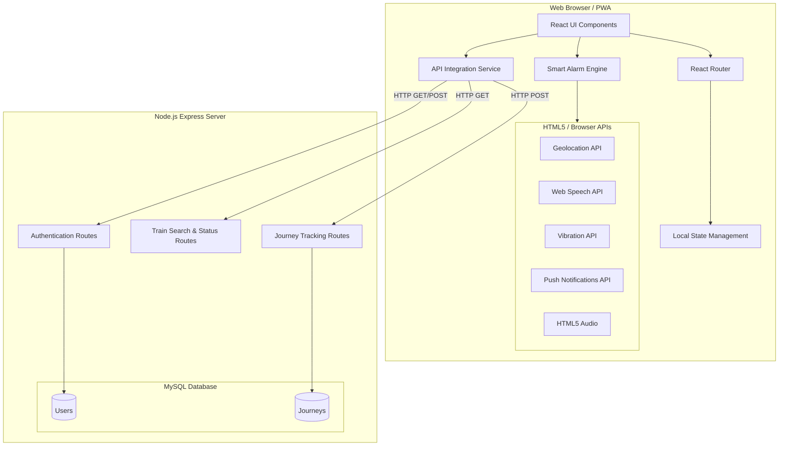
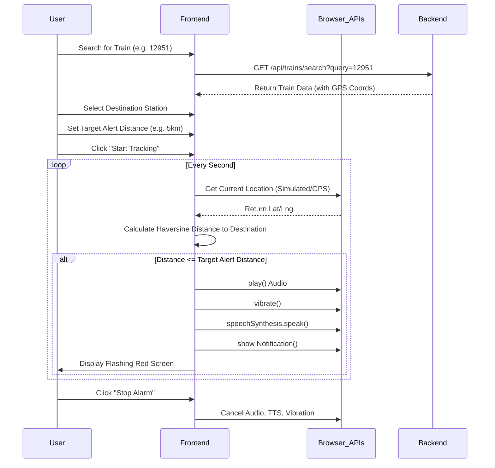
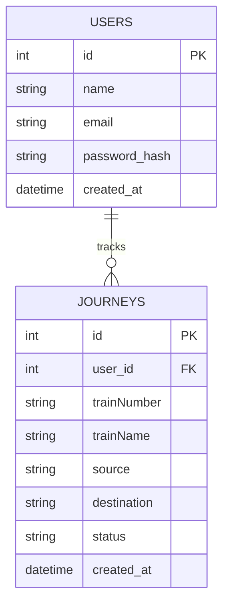

# RailSafe Alert - System Architecture & UML Diagrams

This document contains the structural and behavioral diagrams for the RailSafe Alert system.

## 1. System Architecture

## 2. Sequence Diagram: Smart Alarm Flow

## 3. Database Schema (ER Diagram)

